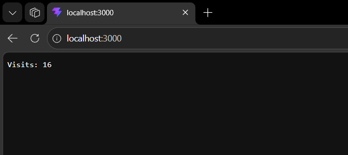
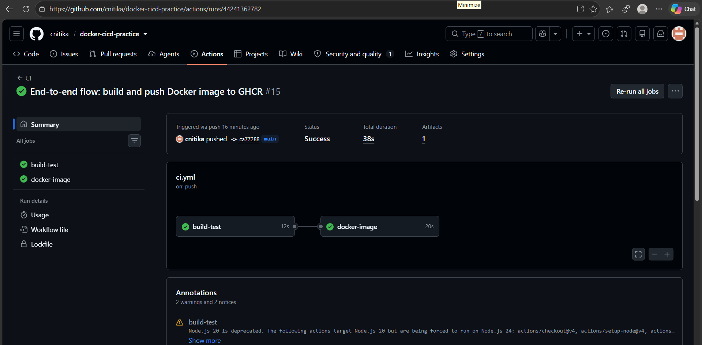
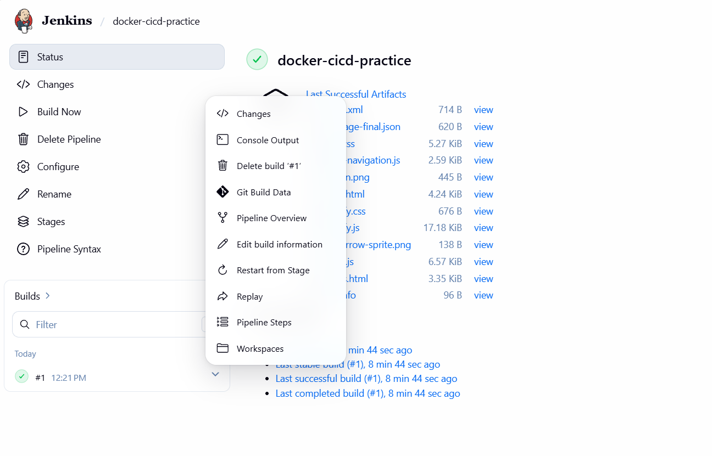
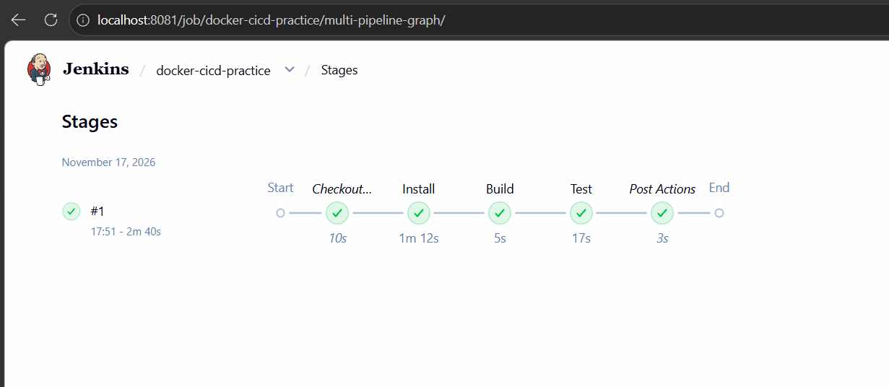
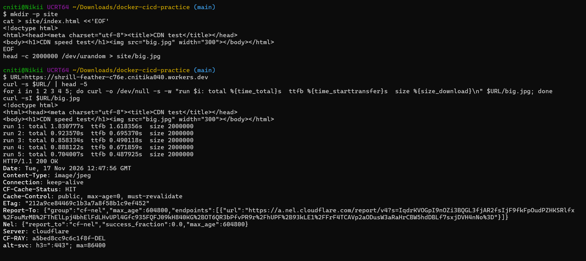
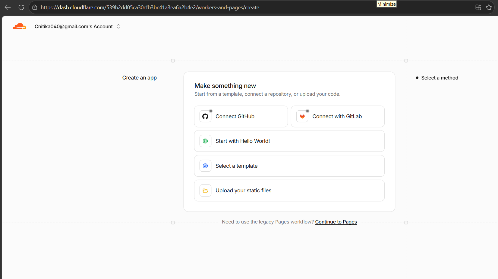

# CI/CD Practice: Final Report (Phase 1 + Phase 2)

I used Claude as a guide and ran and tested everything myself.
Repo: https://github.com/cnitika/docker-cicd-practice

## Phase 1 summary
| Item | Status | Evidence |
|---|---|---|
| Docker + Compose (app + PostgreSQL, healthcheck, volume) | Done | Data survived `down` and `up` (visits count kept) |
| Backup script (pg_dump, timestamped, keeps last 7) | Done | `backup.sh`, 2 timestamped `.sql.gz` files |
| Restore test | Done | `restore_test` DB had 13 rows, same as `appdb` |
| build.sh (npm ci, build, Jest, npx) | Done | `build.sh` in repo |
| GitHub Actions CI with coverage, failing run fixed | Done | `ci.yml`; commits "Break test on purpose" then "Fix test" |
| SSH keys + scp / `transfer.sh` | [FILL: Done or Partial] | `transfer.sh` in repo. [FILL: which machine it was tested on, or "script written, not run against a remote host"] |
| Notes | Done | `notes/docker.md`, `notes/testing.md` |

## Phase 2 summary
| # | Item | Status | Evidence |
|---|---|---|---|
| 1 | PostgreSQL migration to host, app on external DB | Done | Host PostgreSQL 16; app reads/writes host DB via `host.docker.internal` (screenshot 1) |
| 2 | Replication: primary + streaming replica | Done | Replica on port 5433 started from `pg_basebackup -R`; `replicator` role |
| 3 | Verify replication + failover | [FILL: Done / Partial] | Failover: replica promoted, `pg_is_in_recovery()` returned `f`. [FILL: primary insert vs replica count matched? RTO: see `notes/ha.md`] |
| 4 | Files replication (rsync + cron) | Done | `sync.sh` + `docker-compose.sync.yml`; update, new file and delete all synced. Tested between two folders on one machine |
| 5 | Jenkins (Docker) + first pipeline | Done | Jenkins on port 8081; build #1 green (screenshots 3, 4) |
| 6 | Jenkinsfile, artifacts, GH Actions vs Jenkins | Done | `Jenkinsfile`, coverage archived (screenshot 3); comparison in `notes/ci-comparison.md` [FILL: confirm this file was pushed] |
| 7 | Cloudflare / CDN | Done | Static site on Cloudflare; `Server: cloudflare`, `CF-Cache-Status: HIT`, Delhi edge (screenshots 5, 6) |
| 8 | HA concepts write-up | Done | `notes/ha.md` |
| 9 | End-to-end flow | Done | Push, CI (build-test + docker-image), GHCR image, `docker compose pull` and deploy (screenshot 2) |
| 10 | Final report | This file | |

## Screenshots

### 1. App running on the external (host) PostgreSQL

App served from Docker, talking to PostgreSQL installed on the host (Visits counter persisted from the migrated data).

### 2. GitHub Actions: build-test then docker-image

Run #15: both jobs green, coverage artifact uploaded, image pushed to GHCR. After deploying that image the app output changed to `Visits (v2): 18`.

### 3. Jenkins: coverage artifacts archived

`archiveArtifacts` stored the Jest coverage report from build #1.

### 4. Jenkins: pipeline stages

Checkout, Install, Build, Test, Post Actions all green (2m 40s).

### 5. Cloudflare: speed and cache headers

5 timing runs on a 2 MB file: run 1 1.83 s, runs 2-5 0.70-0.92 s. Headers: `Server: cloudflare`, `CF-Cache-Status: HIT`, `CF-RAY: ...-DEL`.

### 6. Cloudflare: deploying the static site

Created via "Upload your static files".

## Limitations (honest notes)
- Primary and replica run on the same machine, so this does not protect against machine or zone failure (see `notes/ha.md`).
- Failover was manual (`pg_ctl promote`); the old primary was not rejoined as a replica.
- File replication was tested between two local folders, not two machines; the remote command is `rsync -az --delete -e ssh src/ user@host:dest/`.
- CDN test has no non-CDN origin to compare against, so it shows edge caching, not a before/after speedup. Run 1 includes DNS/TLS setup.
- Dependabot reported 1 moderate vulnerability (dev dependencies); not yet fixed.
- Failover RTO and any [FILL] items above are to be confirmed from my own runs.

## Next (after this plan)
AWS basics (EC2 start/stop, docs), Kubernetes, and a monitoring overview (Datadog / Nagios / Splunk).

## Phase 2 update (short form for Sir)
> I used Claude as a guide and ran and tested everything myself.
> - PostgreSQL migrated from Docker to the host; app connected to the external DB
> - Streaming replication (primary to replica) set up, failover tested by promoting the replica
> - rsync + cron file sync (tested on one machine)
> - Jenkins pipeline (Jenkinsfile, coverage artifacts) + GitHub Actions vs Jenkins comparison
> - Cloudflare static site with cache HIT proof
> - HA write-up and end-to-end flow: push, CI, Docker image on GHCR, deploy
